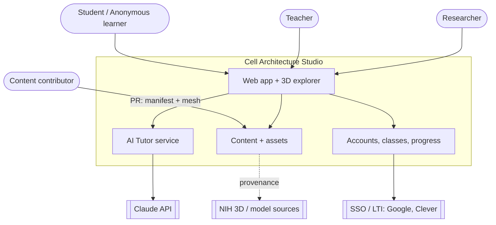
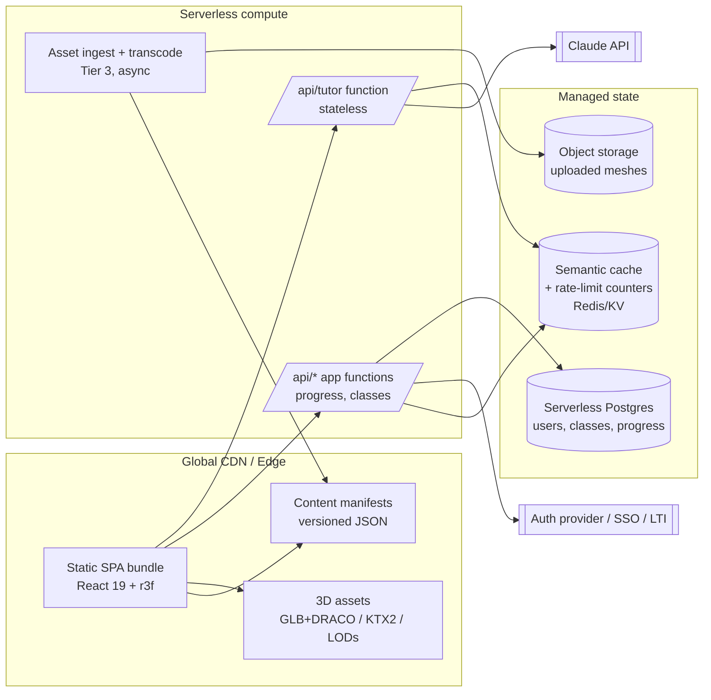
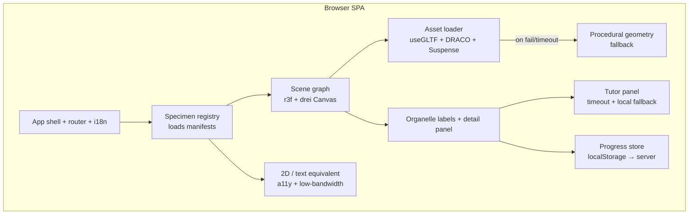
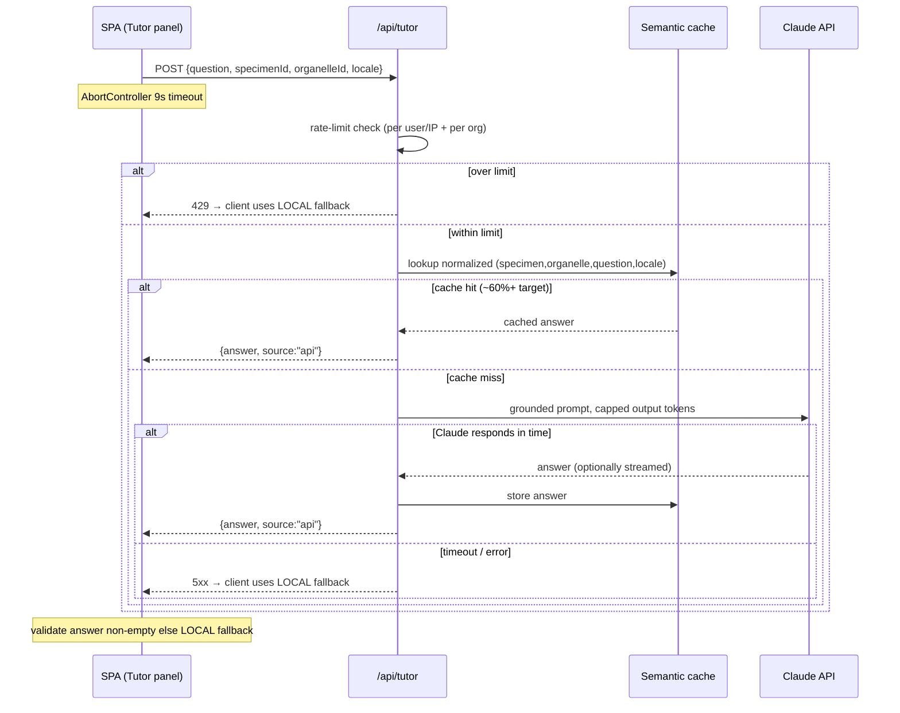
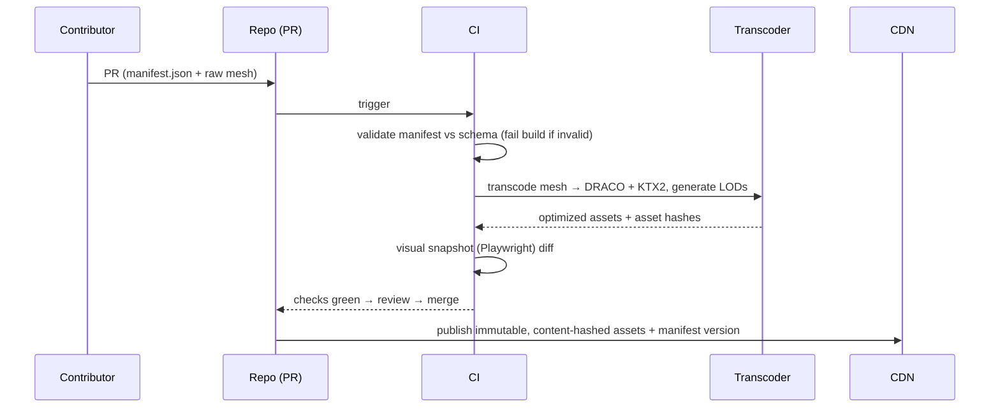
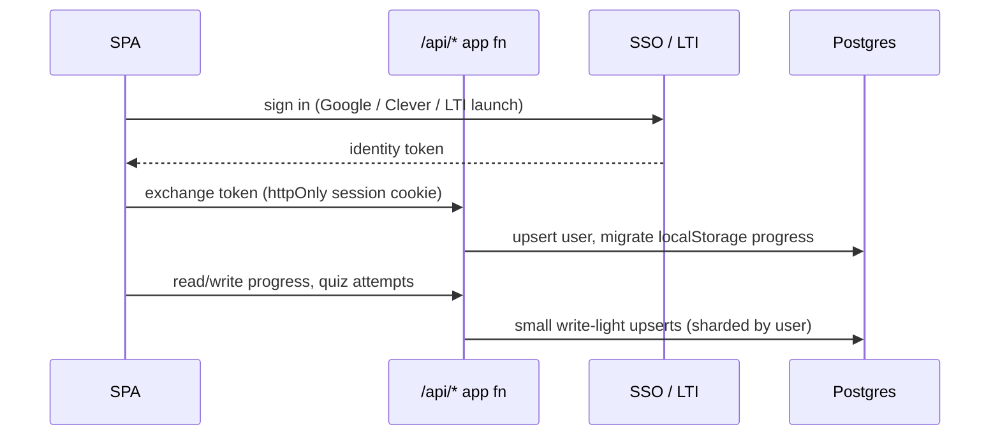
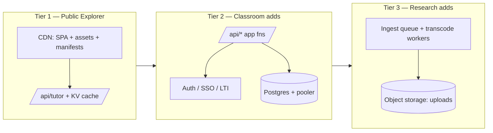

# Reference Architecture — Cell Architecture Studio (Scalable Edition)

**Status:** Draft v1 · **Companion to:** Cell Architecture Studio PRD v1 · **Last updated:** 2026-07-09

This document is the technical counterpart to the PRD. It defines the system's components, how they communicate, how they're deployed at each tier, and the critical runtime flows. Requirement IDs (e.g. `FR-AI-2`, `NFR-P-2`) reference the PRD.

**Guiding principle — push work to the edges and the client.** The heavy, read-mostly things (app bundle, 3D assets, content manifests) are immutable and CDN-cached. The GPU-expensive thing (rendering) runs on the user's device. The only server compute in the hot path is a small, stateless tutor function. Per-user state is the only thing that touches a database, and it's small and write-light. This is what makes the read path effectively un-crashable and the cost curve flat.

---

## 1. System context (C4 level 1)



**Trust boundary:** the browser is untrusted. LLM provider keys, database credentials, and rate-limit state live only server-side. The client never talks to Claude directly (`FR-AI-7`).

---

## 2. Container view (C4 level 2)



| Container | Responsibility | Statefulness | Scaling unit |
|---|---|---|---|
| Static SPA | Render, interact, orchestrate calls | Stateless (client) | CDN edge nodes |
| 3D assets | Immutable meshes/textures/LODs | Immutable | CDN edge cache |
| Content manifests | Specimen/organelle/lesson data | Immutable per version | CDN edge cache |
| `/api/tutor` fn | Ground → cache → LLM → validate | Stateless | Concurrent invocations |
| `/api/*` app fns | Progress, classes, auth callbacks | Stateless | Concurrent invocations |
| Semantic cache / KV | Cached answers, rate counters | Ephemeral-ish | Managed |
| Postgres | Per-user data | Durable, write-light | Read replicas + connection pooler |
| Ingest pipeline | Validate + transcode uploads | Async jobs | Queue workers |

---

## 3. Component view — the client



Key properties (all trace to PRD requirements):
- **Data-driven** — `registry`, `labels`, `textview`, and comparison all read the same manifest; no per-specimen code (`FR-CT-1`).
- **Two independent fallbacks** — `loader → fallback` for meshes (`FR-EX-2`); `tutorui` local answer for the AI (`FR-AI-2`).
- **Text equivalent is first-class** — built from the same organelle data, not a bolt-on (`FR-EX-7`, `NFR-A-1`).

---

## 4. Critical runtime flows

### 4.1 Specimen load with graceful degradation (`FR-EX-2`, `NFR-P-1/2`)

```mermaid
sequenceDiagram
    participant U as User
    participant S as SPA
    participant CDN as CDN
    participant L as Asset loader

    U->>S: select specimen
    S->>CDN: GET manifest (cache-hit at edge)
    CDN-->>S: organelles + asset URLs + LODs
    S->>L: load lowest LOD first (Suspense)
    L->>CDN: GET mesh.glb (DRACO)
    alt success within budget
        CDN-->>L: mesh bytes
        L-->>S: render; stream higher LOD in background
    else fail or >timeout
        L-->>S: render procedural geometry
        S-->>U: usable scene (no dead canvas)
    end
    S->>S: preload next likely specimen only
```

### 4.2 AI tutor request — cache, timeout, fallback (`FR-AI-1..7`, `NFR-S-2/4`)



The client is the last line of defense: any non-answer (429, 5xx, timeout, empty) resolves to a **local fallback answer** so the tutor never blocks a lesson.

### 4.3 Content publish pipeline (`FR-CT-2/3/4`)



A biologist opens a **data-only PR**; the engine never changes. Invalid data can't ship.

### 4.4 Auth + progress sync (Tier 2, `FR-AC-1/3/5`)



---

## 5. Deployment topology by tier

Same codebase; infrastructure grows behind the CDN.



| Tier | New infra | What it unlocks | Cost driver |
|---|---|---|---|
| 1 | CDN + one serverless fn + KV cache | Public explorer, anonymous, at-scale | CDN egress (assets); LLM tokens on cache miss |
| 2 | Auth + Postgres + app fns | Accounts, classes, progress, dashboards | DB + per-user LLM usage (rate-limited) |
| 3 | Ingest queue + workers + blob storage | Upload / annotate / share | Storage + transcode compute (async, bursty) |

---

## 6. Scaling strategy per component

| Component | Bottleneck | Strategy |
|---|---|---|
| 3D assets | Egress + device decode | Immutable content-hashed URLs, aggressive edge cache, DRACO+KTX2, LODs, payload budget `NFR-P-2` |
| SPA | None (static) | Fingerprinted bundles, long-cache immutable, HTML at edge |
| Tutor fn | LLM latency + cost | Semantic cache (≥60% hit `NFR-S-2`), rate limits, cheap default model, streaming, local fallback |
| Content manifests | Read volume | Static + CDN; invalidate only on publish; versioned |
| Postgres | Write contention / connections | Connection pooler, read replicas, shard-by-user access, keep content OUT of DB |
| Ingest | Bursty CPU | Async queue + autoscaling workers; never in the request path |

**Cost control is a design feature, not an afterthought.** The two variable-cost items are CDN egress (bounded by the payload budget) and LLM tokens (bounded by cache-hit rate + rate limits + a cheap default model). Everything else is fixed or near-zero at rest.

---

## 7. Resilience & failure modes

| Failure | Blast radius | Designed response |
|---|---|---|
| Mesh missing/slow | One specimen | Procedural fallback renders; scene stays usable |
| Tutor API down / slow | Tutor panel only | 9s timeout → local fallback answer; explorer unaffected |
| Cache down | Tutor cost/latency | Degrade to direct LLM calls within rate limits |
| LLM rate-limited / erroring | Tutor answers | 429/5xx → local fallback; explorer unaffected |
| Postgres down | Sign-in + progress sync | Explorer + tutor still work anonymously; progress falls back to localStorage |
| CDN region issue | Latency | Multi-region failover; assets immutable so any node serves them |
| WebGL unavailable | Rendering | Text/2D equivalent view (`FR-EX-7`) |

**No failure of any single dependency takes down the core explore-and-learn loop.**

---

## 8. Security & compliance

- **Secrets** (LLM key, DB creds) only in serverless env; never in the client (`FR-AI-7`).
- **Prompt hygiene:** tutor context is specimen/organelle only — **no PII in prompts** (`NFR-C-3`).
- **Sessions:** httpOnly, secure, SameSite cookies; SSO/LTI for schools.
- **Student data:** FERPA/COPPA (US K-12) + GDPR (EU); minors' tutor questions excluded from training; bounded, configurable log retention (`NFR-C-1/2`).
- **Uploads (Tier 3):** validate file type/size, sandbox transcode, scan; uploaded models default to private/unlisted pending an explicit share.
- **Rate limiting:** per user (Tier 2) / per IP (Tier 1) and per org, enforced server-side in the tutor fn.

---

## 9. Technology decisions (with alternatives)

| Decision | Chosen | Alternatives | Why chosen |
|---|---|---|---|
| Framework | React 19 + TS + Vite | SvelteKit, Vue+Nuxt | Matches reference app; largest 3D ecosystem |
| 3D | three.js / r3f / drei | Babylon.js, raw WebGPU | LOD/instancing/Suspense ergonomics; talent pool |
| Geometry compression | DRACO | Meshopt | Broad tooling + drei support (Meshopt is a fine swap) |
| Texture compression | KTX2 / Basis | Plain PNG/JPG | GPU-native, smaller VRAM, faster decode |
| Hosting/CDN | Static SPA + object storage on global CDN | Origin server | Immutable assets belong at the edge |
| Tutor LLM | Claude (fast model default, stronger for open-ended) | Other providers | Grounded Q&A quality + cost tiers; see `claude-api` skill for current IDs/pricing |
| Cache/rate-limit | Redis / edge KV | In-DB | Sub-ms lookups; keeps DB write-light |
| Auth | Managed auth + SSO/LTI | Roll-your-own | Compliance + Google/Clever coverage |
| DB | Serverless Postgres (Neon/Supabase) | DynamoDB | Relational fit for classes/progress; scales to zero |
| Content | Git-backed JSON manifests + CI schema | Headless CMS | Versioned, reviewable, non-dev authoring via PR |
| Verification | Playwright visual snapshots | Manual QA | Reference repo already does this; catches 3D regressions |

> When implementing the tutor, load the `claude-api` skill for current Claude model IDs, pricing, streaming, prompt-caching, and token-counting — don't hard-code them from memory.

---

## 10. Environments & delivery

- **Environments:** `preview` (per-PR), `staging`, `production`. Content manifests versioned so a bad publish rolls back by pointer.
- **CI/CD:** manifest schema validation → asset transcode → unit + Playwright visual snapshots → deploy preview → promote. Immutable, content-hashed assets mean deploys are atomic and instantly cacheable.
- **Observability:** track TTFI (`NFR-P-1`), tutor cache-hit rate, tutor p95 latency, LLM token spend per org, low-end GPU-fail rate — the metrics from PRD §9.
- **Cost dashboards:** CDN egress and LLM tokens broken out per org, alarmed against budget.

---

## Appendix — mapping to reference-app observations

The client-side shape (r3f + drei, DRACO, Suspense/LOD/instancing, `/api/tutor` with 9s abort + local fallback, EN/DE/ES/ZH i18n, data-driven specimens, procedural fallback, Playwright verification) is **observed** in the live app's bundle and public repo. The server-side elements (semantic cache, rate limiting, Postgres/auth, ingest pipeline, tier topology) are **recommended additions** — the reference app's backend is not public and appears to be a single thin tutor endpoint.
